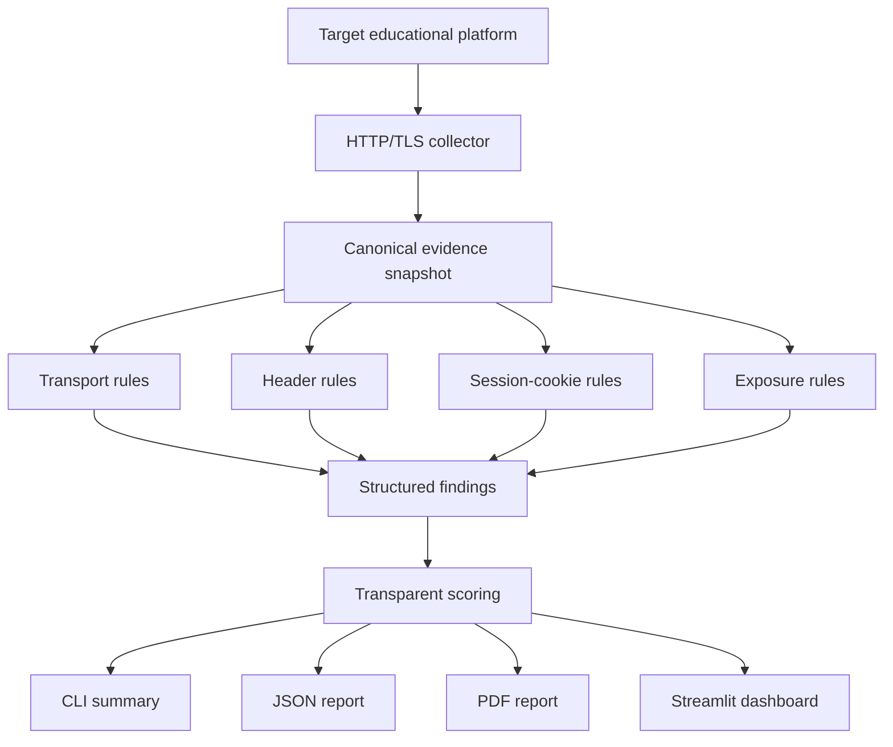

# CyberQuality Static Assessor

A working static, rule-based cybersecurity assessment module for the research project **“AI-Based Model for Analysis and Evaluation of Cybersecurity Quality in Adaptive Educational Platforms.”**

This repository implements the first analytical branch of the proposed dissertation architecture. It collects observable HTTP(S) evidence, evaluates deterministic security rules, preserves traceable findings, calculates transparent dimension scores, and produces human-readable reports. The behavioral AI branch (Isolation Forest) is intentionally outside the scope of this repository version.

## What the module does

- Performs **non-destructive** HTTP(S) checks.
- Evaluates transport/TLS posture.
- Evaluates common HTTP security headers.
- Evaluates session-cookie attributes.
- Detects selected information-exposure indicators.
- Preserves rule ID, severity, category, evidence, source and recommendation.
- Calculates an overall score and dimension-level scores.
- Exports **JSON** and **PDF** reports.
- Provides both a **CLI** and a **Streamlit dashboard**.
- Includes deterministic local insecure/hardened demo targets.
- Includes automated tests, linting, GitHub Actions CI, and tag-based delivery.

## Architecture



## Implemented rule set

| Rule | Dimension | Check |
|---|---|---|
| TRN-001 | Transport Security | HTTPS transport |
| TRN-002 | Transport Security | HSTS |
| TRN-003 | Transport Security | TLS certificate validity window |
| HDR-001 | Web Security Headers | Content-Security-Policy |
| HDR-002 | Web Security Headers | X-Content-Type-Options |
| HDR-003 | Web Security Headers | Clickjacking protection |
| HDR-004 | Web Security Headers | Referrer-Policy |
| HDR-005 | Web Security Headers | Permissions-Policy |
| SES-001 | Session Security | Secure cookie attribute |
| SES-002 | Session Security | HttpOnly cookie attribute |
| SES-003 | Session Security | SameSite cookie attribute |
| EXP-001 | Information Exposure | Server version disclosure |
| EXP-002 | Information Exposure | X-Powered-By disclosure |
| EXP-003 | Information Exposure | Wildcard CORS exposure |

## Technology choices

- **Python 3.12** — concise, portable and appropriate for scientific/security prototyping.
- **httpx** — HTTP client with redirect handling and modern API.
- **ReportLab** — deterministic PDF generation without a browser runtime.
- **Streamlit** — lightweight demonstration UI with minimal frontend overhead.
- **pytest** — automated unit/integration-style testing.
- **Ruff** — fast static linting.
- **GitHub Actions** — CI on pushes/pull requests and delivery on version tags.

## Quick start on Windows

```powershell
py -3.12 -m venv .venv
.\.venv\Scripts\Activate.ps1
python -m pip install --upgrade pip
pip install -r requirements-dev.txt
```

If PowerShell blocks activation, run this once in the current PowerShell window:

```powershell
Set-ExecutionPolicy -Scope Process -ExecutionPolicy Bypass
.\.venv\Scripts\Activate.ps1
```

### 1. Run automated tests

```powershell
python -m pytest --cov=cyberquality --cov-report=term-missing
ruff check .
```

### 2. Start deterministic local demo target

Open terminal 1:

```powershell
python main.py demo-server
```

It exposes:

- `http://127.0.0.1:8765/insecure`
- `http://127.0.0.1:8765/secure`

### 3. Run the CLI assessment

Open terminal 2:

```powershell
python main.py scan --url http://127.0.0.1:8765/insecure --output reports/insecure
python main.py scan --url http://127.0.0.1:8765/secure --output reports/secure
```

Each run creates both `.json` and `.pdf` output files.

### 4. Run the dashboard

```powershell
streamlit run app.py
```

Use the local demo URLs above or an authorized laboratory Moodle endpoint.

## Example CLI output

```text
CyberQuality Static Assessor
==========================================================
Target:       http://127.0.0.1:8765/insecure
Score:        22/100 (Grade F)
Findings: critical=0  high=3  medium=4  low=3  passed=2

Failed checks:
  [HIGH    ] TRN-001  HTTPS transport
  [HIGH    ] HDR-001  Content-Security-Policy
  ...

JSON report: reports/insecure.json
PDF report:  reports/insecure.pdf
```

The exact score is determined by the transparent severity-weighted scoring logic and the observable response.

## Scoring model

Every applicable rule has a severity-derived weight. The score is the percentage of applicable weighted controls that pass. `NOT_APPLICABLE` rules are excluded from the denominator. The same method is applied to each security dimension and to the overall result.

This score is intended for comparison and prioritization. It does **not** hide critical findings; the full evidence remains in the report.

## CI/CD

### Continuous Integration — `.github/workflows/ci.yml`

Every push or pull request to `main` automatically:

1. installs dependencies;
2. runs Ruff linting;
3. runs pytest with coverage;
4. starts the deterministic local demo target;
5. scans both demo profiles;
6. generates JSON/PDF reports;
7. uploads the reports as GitHub Actions artifacts.

### Continuous Delivery — `.github/workflows/release.yml`

Pushing a version tag such as `v0.1.0` automatically creates a distributable ZIP and publishes it in a GitHub Release.

## Repository structure

```text
cyberquality-static-assessor/
├── cyberquality/             # assessment engine
│   ├── rules/                # modular deterministic rules
│   ├── collector.py
│   ├── engine.py
│   ├── models.py
│   ├── reporting.py
│   └── scoring.py
├── demo/                     # deterministic local targets
├── tests/                    # automated tests
├── docs/                     # assignment/demo documentation
├── .github/
│   ├── workflows/            # CI + release delivery
│   └── ISSUE_TEMPLATE/
├── sample_reports/           # example outputs
├── app.py                    # Streamlit UI
├── main.py                   # CLI entry point
├── README.md
├── LICENSE
└── SECURITY.md
```

## Scientific-software characteristics

The module emphasizes reproducibility and traceability:

- explicit dependency versions;
- stable rule IDs;
- versioned scanner output;
- deterministic demo environment;
- machine-readable JSON evidence;
- repeatable automated tests;
- visible scoring logic;
- source/evidence/recommendation fields for every finding.

## Ethical scope

This tool is intentionally non-destructive. It performs observable checks and does not exploit vulnerabilities, brute-force credentials, alter server data, or conduct denial-of-service activity. Use only on systems you own or have permission to assess.

## License

MIT License. See `LICENSE`.
